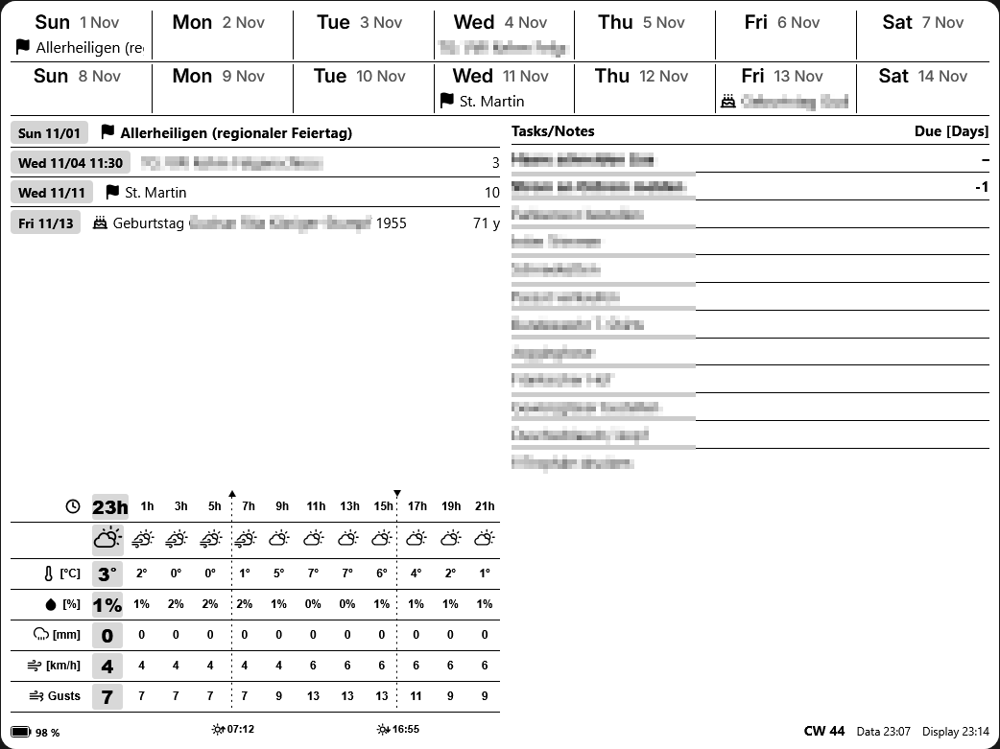
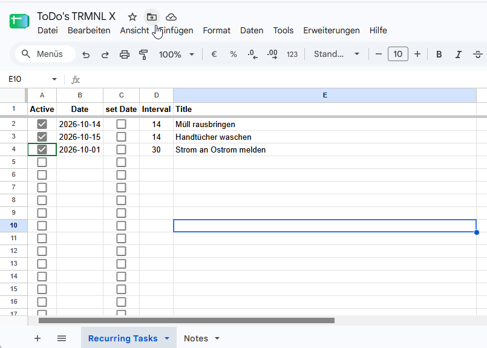
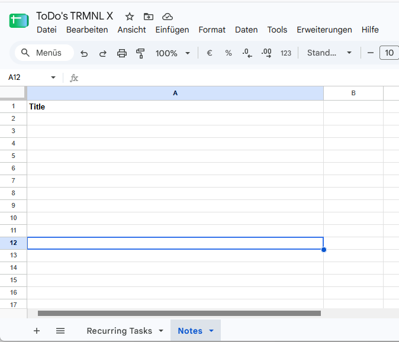

# TRMNL X – Calendar, Weather, Tasks & Notes (Google Apps Script)



A Google Apps Script that collects calendar events, a DWD weather forecast and recurring tasks and notes from a Google Sheet and sends them via webhook to a **TRMNL Private Plugin**.

The code is in the file **`trmnl_feed.gs`**; your personal settings go into a separate file **`config.gs`**, created from the template `config.example.gs`. The optional `waste.gs` adds the waste collection dates. This guide describes how to turn it into a working setup – including the Google Sheet and the small helper script that automatically sets the date when a task is ticked off.

Related files:

| File | Content |
|---|---|
| `trmnl_feed.gs` | Google Apps Script that collects the data and sends it to TRMNL (this guide) – contains no private data |
| `config.example.gs` | Configuration template with placeholders – copy to `config.gs` |
| `config.gs` | Your configuration with private values (webhook URL, location, calendar and spreadsheet IDs) – **not in the repository** (`.gitignore`) |
| `waste.gs` | Optional: next waste collection per bin (district of Rhön-Grabfeld) |
| `.gitignore` | Keeps `config.gs` and HAR recordings (`*.har`) out of Git |
| `ToDo's TRMNL X.gs` | Small helper script bound to the Google Sheet: writes today's date when the checkbox in column C is ticked |
| `trmnl_calendar_todo_weather.md` | Liquid markup for the **Full** tab of the Private Plugin |
| `README_TRMNL_FRONTEND.md` | Setting up the markup in TRMNL |
| `trmnl_calendar_todo_weather_spec.md` | Detailed specification of the whole plugin (layout, payload format, display and calculation logic) |

---

## Prerequisites

- TRMNL account with a TRMNL X device and the **Developer Edition** (required for Private Plugins, see `README_TRMNL_FRONTEND.md`)
- Google account with access to
  - the desired Google calendars
  - Google Sheets
  - Google Apps Script
- The Liquid markup for the display (see `README_TRMNL_FRONTEND.md`)

---

## How the parts fit together

```
 Google Sheet "ToDo's TRMNL X"
 ┌─────────────────────────────────────────────────────────────────────────┐
 │ Recurring Tasks: A Active │ B Date │ C set Date │ D Interval │ E Title  │
 │ Notes:           A Title                                                │
 └──────────────┬──────────────────────────────▲──────────────────────────┘
                │ reads                         │ writes date into B
                │                               │ (when C is ticked)
 ┌──────────────▼──────────────┐   ┌───────────┴──────────────┐
 │ trmnl_feed.gs + config.gs   │   │ ToDo's TRMNL X.gs         │
 │ (+ waste.gs, optional)      │   │ onEdit(e)                 │
 │ pushDataToTrmnl()           │   │ simple trigger, runs on   │
 │ calendar, weather, sheet,   │   │ every edit                │
 │ waste; time-driven trigger  │   │                           │
 └──────────────┬──────────────┘   └───────────────────────────┘
   ▲            │
   │ Google Calendar, Bright Sky (DWD), waste calendar API
                │ webhook (JSON)
                ▼
        TRMNL Private Plugin → TRMNL X display
```

All script files live in the **same Apps Script project, bound to the Google Sheet**. This is the simplest setup; alternatives are described in step 3.

**Typical everyday flow:**

1. A task is due and appears on the display (e.g. "Take out the bins – today").
2. After doing it, you tick the checkbox in **column C** of the sheet (on your phone, for example).
3. `onEdit` writes today's date into **column B** and immediately resets the checkbox.
4. On the next run of `pushDataToTrmnl` the task is `Interval` days away again and disappears from the display until it is due again.

---

## Steps overview

1. Create a TRMNL Private Plugin and copy the webhook URL
2. Create and set up the Google Sheet
3. Create the Apps Script project on the sheet and add both scripts
4. Adjust the configuration
5. Check the time zones
6. First run and permissions
7. Test "set date" (PC, phone, shared users)
8. Set up the trigger for regular updates
9. Add the markup in TRMNL and check the result
10. Before publishing on Git: keep private values out

---

## 1. Create a TRMNL Private Plugin

1. In the TRMNL dashboard, create a new **Private Plugin** under **Plugins**.
2. Give it a name, e.g. "Calendar & Weather".
3. Choose **Webhook** as the strategy and save.
4. Copy the displayed **webhook URL**. It has the form
   `https://trmnl.com/api/custom_plugins/<plugin ID>`
5. Add the plugin to a playlist of the device.

---

## 2. Create and set up the Google Sheet

### 2.1 New spreadsheet

1. Create a **blank spreadsheet** in Google Sheets.
2. Give it a name at the top left, e.g. **"ToDo's TRMNL X"** (the name is arbitrary; the script finds the spreadsheet by its ID).
3. Set **File → Settings → General → Time zone** to **(GMT+01:00) Berlin**. Locale e.g. **Germany**. Save.

The time zone matters: the helper script `onEdit` determines today's date in the spreadsheet's time zone. If it were set to e.g. GMT-8, it would already enter "tomorrow" in the evening or still "yesterday" in the morning.

### 2.2 Create the sheets

Create or rename the sheets at the bottom left (right-click the tab → **Rename**). The names must be **exactly** as follows – or be adjusted in the configuration:

| Sheet | Purpose |
|---|---|
| `Recurring Tasks` | recurring tasks |
| `Notes` | free-form notes |

Upper/lower case and spaces matter.

### 2.3 Sheet "Recurring Tasks"



**Target layout:**

| | A | B | C | D | E |
|---|---|---|---|---|---|
| **1** | **Active** | **Date** | **set Date** | **Interval** | **Title** |
| 2 | ☑ | 2026-10-14 | ☐ | 14 | Müll rausbringen |
| 3 | ☑ | 2026-10-15 | ☐ | 14 | Handtücher waschen |
| 4 | ☑ | 2026-10-01 | ☐ | 30 | Strom an Ostrom melden |
| 5 | ☐ | | ☐ | | |

**Meaning of the columns:**

| Column | Header | Content | Written by | Used by the push script |
|---|---|---|---|---|
| A | Active | Checkbox: active (`x`) / inactive (`-`) | user | yes – active rows only |
| B | Date | Date the task was last done | `onEdit` (or the user manually) | yes |
| C | set Date | Checkbox "done now" | user, reset immediately | **no, ignored** |
| D | Interval | Repetition in days (integer ≥ 1) | user | yes |
| E | Title | Name of the task | user | yes |

Important distinction: **column A** switches a task on or off permanently. **Column C** reports "done today". To tick off a completed task, always use **C**, not A.

#### Step 1 – Headers

Enter in row 1: `A1` Active, `B1` Date, `C1` set Date, `D1` Interval, `E1` Title.
Optional: make row 1 bold and freeze it via **View → Freeze → 1 row** so it stays visible when scrolling.

Row 1 is skipped by both scripts.

#### Step 2 – Column A: checkbox with values `x` / `-`

The push script treats a task as active if the cell contains `x`. Column A therefore needs a checkbox with **custom values**:

1. Select the range `A2:A100` (or as far down as you plan tasks).
2. **Insert → Checkbox**.
3. Keep the range selected and open **Data → Data validation**.
4. In the side panel, click the rule for the range.
5. Under "Criteria" (checkbox), enable **"Use custom cell values"**.
6. **Checked:** `x` – **Unchecked:** `-`
7. **Done**.

Check: tick a checkbox and select the cell. The formula bar at the top must show `x`, and `-` when unchecked.

A standard checkbox without custom values (`TRUE`/`FALSE`) also works; checked then counts as active. The `x`/`-` variant is easier to read when exporting or filtering the values, though.

#### Step 3 – Column B: date

1. Select the range `B2:B100`.
2. Optional, for a uniform look: **Format → Number → Custom date and time** → format `YYYY-MM-DD` (e.g. 2026-10-18).
3. Optional, against typos: **Data → Data validation → Add rule** → criterion **"Is valid date"** → "Reject the input". (The reference sheet uses an equivalent custom formula that also accepts date text: `=OR(NOT(ISERROR(DATEVALUE(B2))), ISNUMBER(B2))`.)

Allowed content (all understood by the push script):

| Content | Effect |
|---|---|
| real date (e.g. via `onEdit` or typed in) | normal calculation |
| text `2026-10-18` or `18.10.2026` | also recognised |
| empty | task counts as "never done" and is **always** shown |
| other text | row is skipped, note in the log |

#### Step 4 – Column C: checkbox "set Date"

Column C is the "done today" button. Ticking it runs the helper script `ToDo's TRMNL X.gs`, which writes today's date into column B and clears the checkbox again.

**Why a checkbox?** The Google Sheets app on **Android** cannot run macros, custom menus or drawing/image buttons with an assigned script – on a phone these simply do nothing. The one thing the app does reliably is trigger the `onEdit` function when a cell is edited. Ticking a checkbox is a cell edit, so a checkbox is practically the only way to "press a button" that runs script code from an Android phone. It also works on iOS, on a PC and for everyone the spreadsheet is shared with (section 2.6).

Use **a normal checkbox without custom values** here. The helper script checks for the value `TRUE`.

1. Select the range `C2:C100`.
2. **Insert → Checkbox**.
3. Do **not** set custom values.

If you set `x`/`-` here as well, `onEdit` no longer reacts, because it waits for `TRUE`.

#### Step 5 – Column D: interval

1. Select the range `D2:D100`.
2. **Format → Number → Number**, then reduce the decimal places to 0 via the toolbar (or **Custom number format** `0`).
3. Optional: **Data → Data validation → Add rule** → criterion **"Custom formula is"** → `=AND(ISNUMBER(D2), D2=INT(D2), D2>=1)` → "Reject the input". This only allows whole numbers from 1 and allows empty cells.

With a German locale, formulas use `;` instead of `,` as the argument separator, e.g. `=UND(ISTZAHL(D2); D2=GANZZAHL(D2); D2>=1)` – Google Sheets usually translates English function names automatically.

Only **whole numbers from 1** are allowed. Decimals, `0` or text cause the row to be skipped (note in the log).

#### Step 6 – Column E: title

Free text. Rows without a title are ignored. Short titles fit the display better.

#### Prepared empty rows

It is convenient to prepare the rows in advance, as in the reference sheet: checkboxes in A (unchecked = `-`) and C down to e.g. row 100, everything else empty. To add a task, enter the interval and the title, tick A, and either tick C (if it was just done) or leave B empty (shown immediately as "never done"). Rows with an unchecked A are ignored even if they contain data, so tasks can be paused without deleting them.

#### When does a task appear on the display?

All conditions must be met:

1. Column A is checked (`x`).
2. Column D contains a whole number ≥ 1.
3. Column E is not empty.
4. Column B is empty **or** the task is due in at most 2 days or overdue.

Due date: `due_in_days = Date + Interval − today`

Example from the screenshot, calculated for 18 Oct 2026:

| Title | Date | Interval | due on | due_in_days | shown? |
|---|---|---|---|---|---|
| Müll rausbringen | 14 Oct | 14 | 28 Oct | 10 | no, only from 26 Oct |
| Handtücher waschen | 15 Oct | 14 | 29 Oct | 11 | no, only from 27 Oct |
| Strom an Ostrom melden | 1 Oct | 30 | 31 Oct | 13 | no, only from 29 Oct |

The lead time of 2 days can be changed via `TASK_LEAD_DAYS` in the configuration. The markup has its own setting `task_lead_days`, which can only restrict further (see `README_TRMNL_FRONTEND.md`).

### 2.4 Sheet "Notes"



| | A |
|---|---|
| **1** | **Title** |
| 2 | first note |
| 3 | second note |

1. Enter the header `Title` in `A1`.
2. From `A2` on, one note per row.

All non-empty cells in column A from row 2 on are sent, in the order of the sheet. Empty rows in between do no harm. Notes are always shown as long as they are in the sheet – to remove one, clear the cell or delete the row.

Long notes increase the payload (limit 5 KB, see troubleshooting).

### 2.5 Note the spreadsheet ID

The ID is in the address bar between `/d/` and `/edit`:

```
https://docs.google.com/spreadsheets/d/<SPREADSHEET_ID>/edit
                                       └─ spreadsheet ID ─┘
```

### 2.6 Share the spreadsheet

The spreadsheet can be shared with family members so that everyone can tick off tasks and add notes – on a PC or in the Google Sheets app.

1. In the spreadsheet click **Share** (top right).
2. Enter the Google account of the person.
3. Choose the role:

| Role | Can tick off tasks (column C) | Can add/edit tasks and notes | Can see the Apps Script code (Extensions → Apps Script) |
|---|---|---|---|
| **Editor** | yes | yes | **yes** – and can change it |
| Commenter | no | no | no |
| Viewer | no | no | no |

4. Leave **General access** at **Restricted**. Do not use "Anyone with the link": the spreadsheet ID is part of the link and appears in the script configuration.
5. **Send**.

Only **editors** can tick checkboxes, because ticking is an edit. The helper script `onEdit` then runs for them automatically; they do not need to authorise anything.

**Important – editors can read the bound script.** Everyone with edit access to the spreadsheet can open **Extensions → Apps Script** and see (and change) every script in the bound project. If `trmnl_feed.gs` is also in this project, editors can read your **TRMNL webhook URL**, calendar IDs, coordinates and waste location from `config.gs`. If you share the spreadsheet with anyone, put `trmnl_feed.gs`, `config.gs` and `waste.gs` into a separate **standalone** project instead (section 3.6) and keep only `ToDo's TRMNL X.gs` in the bound project.

---

## 3. Create the Apps Script project and add the scripts

### 3.1 Create the project on the sheet

1. In the Google Sheet, open **Extensions → Apps Script**.
2. A new Apps Script project opens that is **bound to this spreadsheet**.
3. Rename the project at the top left, e.g. **"TRMNL Feed"**.

Why bound? The helper script `onEdit` **only** works in a project that is bound to the spreadsheet. A standalone project under `script.google.com` does not receive the spreadsheet's edit events.

The setup below puts all script files into this bound project, which is the simplest option if **only you** edit the spreadsheet. If the spreadsheet is shared with other editors, use the variant in section 3.6 (see the warning in 2.6).

### 3.2 Files 1 and 2: push script (`trmnl_feed.gs`) and configuration (`config.gs`)

1. Under **Files** on the left, open the existing file **`Code.gs`** and rename it to **`trmnl_feed`** (⋮ next to the file → **Rename**; the `.gs` extension is added automatically).
2. Delete its entire content, paste the **complete content** of `trmnl_feed.gs` and save (`Ctrl + S`).
3. Click **+** next to **Files** → **Script**, name it **`config`**.
4. Delete the default content and paste the content of your local `config.gs`. If you do not have one yet, paste `config.example.gs` and fill it in (step 4).
5. Save.

All `.gs` files of an Apps Script project share one global scope, so `trmnl_feed.gs` uses the `CONFIG` object from `config.gs`. The order of the files does not matter. The file names in the editor are only labels.

If `config.gs` is missing or still contains placeholders, the script sends nothing and logs `CONFIG missing …` or `CONFIG not filled in …`.

### 3.3 File 3 (optional): waste collection (`waste.gs`)

`waste.gs` adds the next collection date for the black, yellow and blue bin to the payload (field `waste`). The display shows the days until each collection, e.g. "Black 🗑 14 | Yellow 🗑 28 | Blue 🗑 14".

**Only for the district of Rhön-Grabfeld.** The dates come from the JSON interface behind the collection calendar on [abfallinfo-rhoen-grabfeld.de](https://www.abfallinfo-rhoen-grabfeld.de/service/abfuhr-wecker) (provider sqronline.de). It is unofficial and may change without notice. Other districts need a different source.

Setup:

1. Click **+** next to **Files** → **Script**, name it **`waste`**, delete the default content, paste `waste.gs` and save.
2. Select **`listWasteAreas`** in the function dropdown and click **Run**. The log lists every municipality and district with its IDs, e.g. `Musterdorf (CITY_ID 4) → Musterortsteil (AREA_ID 26)`.
3. Enter both IDs in `config.gs` as `WASTE_CITY_ID` and `WASTE_AREA_ID` and save.
4. Run **`testWaste`**. The log shows the result, e.g.
   ```
   Waste: API fetched, 42 dates stored
   [ { "key": "waste", "label": "Schwarz", "date": "2026-11-06" }, … ]
   ```

Nothing has to be changed in `trmnl_feed.gs`: `pushDataToTrmnl()` calls `getWasteData()` automatically when `waste.gs` is in the project. Without `waste.gs` the field `waste` is simply omitted and the markup hides the waste line.

How it works:

| Behaviour | Detail |
|---|---|
| Fetching | at most **once per day**; the dates are stored in the project's **Script Properties** (Project Settings → Script Properties, key `waste_<city>_<area>`) |
| API outage | the last stored dates are used; the next attempt follows after `RETRY_HOURS` (2 h) |
| Collection today | counts as "today" until `TODAY_UNTIL` (9:00); after that the next date is sent |
| Payload | `[{ "key": "waste", "label": "Schwarz", "date": "yyyy-MM-dd" }, …]`, `date` is `null` if no future date is known; `[]` if nothing could be loaded |

Settings in `waste.gs` (object `WASTE`, normally unchanged):

| Key | Default | Meaning |
|---|---|---|
| `BINS` | black (id 9), yellow (13), blue (3) | Bins to send, in this order. `key` selects the English name in the markup, `label` the German one. Other IDs: 11 = organic, 1 = hazardous |
| `RETRY_HOURS` | `2` | Wait time after a failed fetch |
| `TODAY_UNTIL` | `9` | Hour until which a collection today is still shown as "today" |
| `DIVISION_UUID` | district calendar | ID of the Rhön-Grabfeld collection calendar at the provider |

After changing `WASTE_CITY_ID`/`WASTE_AREA_ID`, run **`clearWasteCache`** once so the new location is fetched immediately.

#### How `waste.gs` was created – and how to adapt it to another provider

The Rhön-Grabfeld waste management has no documented API. Its website, however, loads the collection dates dynamically from a JSON interface in the browser. `waste.gs` calls exactly this interface. The same approach works for many other providers:

**0. Check for a simple export first.** Many waste calendars offer an **iCal/ICS** subscription or a CSV/PDF download. An ICS link is usually more stable than an internal interface. It can be added directly to Google Calendar (then the dates appear as normal events), or parsed in a script instead of the JSON.

**1. Record the network traffic in the browser.**

1. Open the provider's collection calendar page.
2. Open the developer tools (`F12`) → tab **Network**.
3. Enable **Preserve log** and filter by **Fetch/XHR**.
4. Perform the query on the page as usual (select municipality, district, show dates).
5. Look for requests whose response is JSON with dates (preview tab). Here this was `…/api/modules/abfall/webshow?module_division_uuid=…&cityIds=…&areaIds=…`.
6. Save the recording: right-click in the request list → **Save all as HAR** (or the download icon). A HAR file contains all requests and responses of the session.

**2. Analyse the recording** – by hand in the developer tools or by letting an AI assistant evaluate the HAR file. `waste.gs` was created this way from a HAR file. Questions to answer:

| Question | Answer for Rhön-Grabfeld |
|---|---|
| Which request delivers the dates? | `GET https://aht1gh-api.sqronline.de/api/modules/abfall/webshow` |
| Which parameters select the location? | `module_division_uuid` (district calendar), `cityIds` (municipality), `areaIds` (district) |
| Is there a request for the list of locations? | the same URL with `onlyConf=true` → `mdiv.config.cities` / `mdiv.config.areas` (used by `listWasteAreas`) |
| Which headers are required? | `Accept: application/json` and `Referer` of the provider's website; no login, no cookie |
| Where are the dates in the response? | `abfall_dates[]` with `date` (`yyyy-MM-dd`), `abfall_type_id`, `comment` |
| How are bin types named? | `mdiv.config.abfall_types.normal/special[]` with `id` and `name` (9 = residual, 13 = yellow, 3 = paper, …) |
| How far ahead are dates available? | check the last date in the response; `waste.gs` stores what is delivered and logs the last stored date |

To test, call the URL with the found parameters directly in the browser or in Apps Script (`UrlFetchApp.fetch`) and compare the response with the recording.

**3. Adapt `waste.gs`.** Only three places depend on the provider:

| Function | Adapt |
|---|---|
| `fetchWasteJson_()` | URL, parameters and headers of the request |
| `loadWaste_()` | mapping of the response to `[date, typeId, note]` (here `d.date`, `d.abfall_type_id`, `d.comment`) |
| `wasteTypeNames_()` / `listWasteAreas()` | where type names and locations are in the response (or remove them if the provider has none) |

Everything else – daily storage, fallback on outages, `TODAY_UNTIL`, the output format for the markup (`[{ key, label, date }]`) – can stay as it is. `BINS` must contain the type IDs of the new provider.

**Notes**

- **HAR files can contain private data:** cookies, login tokens, your address or customer number, and everything else that was loaded during the recording. Record only the required page, ideally in a private window without being logged in, and remove sensitive values (or do not share the file) before passing it on. Do not commit HAR files to Git (`.gitignore` excludes `*.har`).
- Internal interfaces are **unofficial**: they can change or disappear at any time, and their use may be governed by the provider's terms of use. Fetch rarely – `waste.gs` calls the interface at most once per day.

### 3.4 File 4: set the date when ticking off (`ToDo's TRMNL X.gs`)

1. Click **+** next to **Files** → **Script**.
2. Name: **`ToDo's TRMNL X`** (the `.gs` extension is added automatically; any name works).
3. Delete the default content (`function myFunction() {}`).
4. Paste the content of `ToDo's TRMNL X.gs`:

```javascript
function onEdit(e) {
  if (!e) return;

  var range = e.range;
  var sheet = range.getSheet();

  // SETTINGS:
  var checkColumn = 3; // Column C (checkboxes are here)
  var dateColumn = 2;  // Column B (the date is written here)

  // When a checkbox in column C is ticked (TRUE)
  if (range.getColumn() == checkColumn && e.value == "TRUE") {
    var row = range.getRow();
    if (row === 1) return; // Skip the header row

    // Format the current date as YYYY-MM-DD in the spreadsheet's time zone
    var timeZone = SpreadsheetApp.getActiveSpreadsheet().getSpreadsheetTimeZone();
    var formattedDate = Utilities.formatDate(new Date(), timeZone, "yyyy-MM-dd");

    // 1. Write the plain date into column B to the left
    var dateCell = sheet.getRange(row, dateColumn);
    dateCell.setValue(formattedDate);

    // 2. Immediately reset the checkbox in column C to empty (FALSE)
    range.setValue(false);
  }
}
```

5. Save.

**What the code does:**

| Line | Effect |
|---|---|
| `if (!e) return;` | Stops when the function is started manually in the editor (there is no event then) |
| `checkColumn = 3`, `dateColumn = 2` | Checkbox in C, date in B. Adjust here for a different column layout |
| `e.value == "TRUE"` | Only reacts to **ticking**, not to unticking |
| `row === 1` | The header is ignored |
| `getSpreadsheetTimeZone()` | Today's date in the spreadsheet's time zone (hence step 2.1) |
| `setValue(formattedDate)` | Writes e.g. `2026-10-18` into column B; Sheets converts the text into a date |
| `range.setValue(false)` | Resets the checkbox immediately so it is ready for next time |

### 3.5 Notes on the shared project

- **Only one `onEdit` function per project.** If there are several functions with this name (even in different files), only one of them runs. Further edit automations must go into the same `onEdit` function.
- **The push script does not react to edits.** It only runs via the time-driven trigger (step 8) or manually.
- **The order of the files does not matter.** `config.gs` and `waste.gs` are only read when `pushDataToTrmnl` runs.
- `onEdit` does not check the sheet name. A checkbox in column C of another sheet would also set a date in column B. As long as "Notes" has nothing in column C, this is harmless. If you add more sheets, add `sheet.getName() == "Recurring Tasks" &&` at the start of the condition.

### 3.6 Alternative: separate push script

The push script can also live in a standalone project under `script.google.com` (e.g. when serving several spreadsheets or devices). Then:

- `trmnl_feed.gs`, `config.gs` and `waste.gs` go into the standalone project.
- `ToDo's TRMNL X.gs` **still** stays in the project bound to the spreadsheet (Extensions → Apps Script).
- Editors of the shared spreadsheet only see the small helper script, not your webhook URL and calendar IDs.

Setup: open `https://script.google.com` → **New project**, rename it e.g. "TRMNL Feed", add `trmnl_feed.gs`, `config.gs` (and `waste.gs`) as in 3.2/3.3, then continue with steps 4–8 in this project.
- The push script finds the spreadsheet via `SPREADSHEET_ID`; trigger and permissions are set up in the standalone project.

---

## 4. Adjust the configuration

The `CONFIG` object is in `config.gs`. Create it once from the template:

1. Copy `config.example.gs` to `config.gs` (locally, next to the other files).
2. Replace every `<...>` placeholder and the example coordinates with your own values.
3. Paste `config.gs` into the Apps Script project (section 3.2).

The following values **must** be adjusted:

| Key | What to enter | Where to find it |
|---|---|---|
| `TRMNL_WEBHOOK_URL` | Webhook URL from step 1 – treat it like a password: anyone who knows it can send data to your display | TRMNL plugin settings |
| `LATITUDE` / `LONGITUDE` | Coordinates of the location (decimal degrees) | e.g. right-click the place in Google Maps |
| `CALENDAR_IDS` | List of calendar IDs | Google Calendar → settings of the calendar → **Integrate calendar → Calendar ID**; your own primary calendar has your Gmail address as ID |
| `SPREADSHEET_ID` | ID from step 2.5 | Address bar of the spreadsheet |

`SPREADSHEET_ID` must be set even in the bound project, because the script opens the spreadsheet by its ID.

Optional:

| Key | Default | Meaning |
|---|---|---|
| `HOLIDAY_CALENDAR_IDS` | `['de.german#holiday@group.v.calendar.google.com']` | Holiday calendars, fetched in addition to `CALENDAR_IDS`; their events get `public_holiday: true`. Do not also list them in `CALENDAR_IDS`. |
| `TIMEZONE` | `"Europe/Berlin"` | Time zone for all date and time values |
| `DAYS_AHEAD` | `14` | Days in the calendar grid from today (must match `cal_days` in the markup, e.g. 2 × 7) |
| `BIRTHDAY_KEYWORDS` | `geburtstag`, `birthday`, `bday` | Words by which birthdays are recognised (in the title or calendar name) |
| `WEATHER_HOURS` | `24` | Forecast period in hours |
| `WEATHER_POINTS` | `12` | Number of weather values (24 / 12 = blocks of 2 h) |
| `SHEET_TASKS` | `"Recurring Tasks"` | Name of the task sheet |
| `TASK_COLS` | `{ active: 0, date: 1, interval: 3, title: 4 }` | Column mapping (A = 0, B = 1, …); column C is deliberately left out |
| `SHEET_NOTES` | `"Notes"` | Name of the notes sheet |
| `TASK_LEAD_DAYS` | `2` | How many days before the due date a task is sent |
| `NOTES_HAS_HEADER` | `true` | Skip row 1 in the notes sheet |
| `WASTE_CITY_ID` / `WASTE_AREA_ID` | `null` in the template | Location for `waste.gs` (section 3.3); without them no waste dates are sent |
| `PAYLOAD_LIMIT` | `5000` | Size warning in the log (TRMNL+: 10000) |
| `DEBUG_LOG_PAYLOAD` | `true` | Write the sent JSON to the log; set to `false` in regular operation |

If columns in the sheet are moved, **both** places must be adjusted: `TASK_COLS` in `config.gs` and `checkColumn`/`dateColumn` in `ToDo's TRMNL X.gs`. Note: `TASK_COLS` counts from 0 (A = 0), `ToDo's TRMNL X.gs` from 1 (A = 1).

Save after adjusting.

---

## 5. Check the time zones

Three places should be set to Berlin:

| Place | Where | Affects |
|---|---|---|
| Spreadsheet | Sheet: **File → Settings → Time zone** | Date entered by `onEdit`; interpretation of date cells |
| Apps Script project | Editor: **Project Settings** (gear icon) → **Time zone** | Day boundaries in the calendar grid, all-day events |
| `CONFIG.TIMEZONE` | `config.gs` | Formatting of all date and time values, due date calculation |

If they do not match, days in the calendar or the due dates of tasks shift by one day.

The time zone of the **Google calendars themselves** does not matter: all-day events are read independently of it (via `getAllDayStartDate`/`getAllDayEndDate`).

---

## 6. First run and permissions

1. Open the file `trmnl_feed.gs` in the editor.
2. Select **`pushDataToTrmnl`** in the function dropdown at the top.
3. Click **Run**.
4. Google asks for permissions for:
   - Google Calendar (read)
   - Google Sheets
   - Connecting to external services (Bright Sky API and TRMNL webhook)
5. Choose the account. If **"Google hasn't verified this app"** appears: **Advanced** → **Go to "TRMNL Feed" (unsafe)**. This is normal for your own scripts.
6. Confirm the permissions. The script then runs.

`onEdit` needs **no** permission: as a simple trigger it may edit its own spreadsheet without consent.

**Check the result** in the execution log at the bottom of the editor:

```
Starting data fetch for TRMNL X...
Weather: 12 values of 2 h
Sun: sunrise 07:49, sunset 18:22
Recurring tasks sent: 0
Notes sent: 0
Waste: Schwarz 2026-11-06, Gelb 2026-11-20, Blau 2026-11-06 (as of 2026-11-01, last stored date: 2027-01-15)
Payload size: 3412 bytes
Payload JSON: { … }
TRMNL Response Code: 200
```

`200` means: TRMNL accepted the data.

`Recurring tasks sent: 0` is correct for recently completed tasks (see the example in 2.3). For testing, create a task with an empty date or a date far in the past.

---

## 7. Test "set date"

### 7.1 On a PC

1. Go back to the spreadsheet, sheet **Recurring Tasks**.
2. Tick the checkbox in **column C** of a task row.
3. After one or two seconds, today's date must appear in **column B** and the checkbox in C must be empty again.

`onEdit` **cannot** be tested meaningfully via "Run" in the editor – the edit event is missing there and the function exits immediately. Always test by ticking in the spreadsheet.

Runs of `onEdit` appear in the editor under **Executions** (type "Simple Trigger").

### 7.2 On a phone

1. Install the **Google Sheets app** (Android/iOS) and sign in with the same or an authorised account.
2. Open the spreadsheet and tap the checkbox in column C.
3. The date appears in column B after a short delay.

This is exactly why the checkbox solution exists (see section 2.3, step 4): buttons, custom menus and macros do not work in the Sheets app on Android, but editing a cell does trigger `onEdit`. Editing via the Sheets website in a mobile browser is limited; use the app.

### 7.3 With other people

1. Share the spreadsheet with the person as **Editor** (section 2.6).
2. Ask them to tick the checkbox in column C of a test row on their PC or phone; `onEdit` sets the date for them too.

Users with the role **Viewer** or **Commenter** cannot change checkboxes and therefore cannot mark anything as done.

### 7.4 Limits of `onEdit`

- Only reacts to **edits by people**. If a script changes the cell, `onEdit` is not triggered.
- When **pasting several cells** at once (copying and pasting a range), no date is set.
- **Ticking by mistake** sets the date to today; to correct it, change the date in column B manually (**Ctrl + Z** only undoes the last change and may need to be pressed several times).
- Runs for at most 30 seconds per call – not an issue for this small function.

---

## 8. Trigger for regular updates

The push script only runs when it is called. For regular updates, create a **time-driven trigger**:

1. In the editor, click **Triggers** (alarm clock icon) on the left.
2. **Add Trigger** (bottom right).
3. Settings:
   - Function to run: **`pushDataToTrmnl`**
   - Deployment: **Head** (German UI: "Testbereitstellung")
   - Event source: **Time-driven**
   - Type: **Minutes timer**
   - Interval: **Every 30 minutes** (or every 15 minutes)
4. Save.

**No** trigger is created for `onEdit` – the function name alone is enough; Google calls it automatically on every edit. An additional installable trigger on `onEdit` would run the function twice.

**Head** means: the trigger always runs the most recently saved code. Changes take effect on the next run without further steps.

**Not more often than every 15 minutes:** TRMNL allows a standard account at most **12 webhook requests per hour** (TRMNL+: 30). More requests are rejected with `429`. A 5-minute interval would be exactly at the limit; every manual test run would exceed it. How often the display redraws is also determined by the refresh setting in TRMNL.

**Delay after ticking off:** a completed task only disappears from the display after the next trigger run **and** the next display refresh – with a 30-minute interval, in the worst case after about an hour.

All trigger runs including their logs are listed in the editor under **Executions**.

---

## 9. Add the markup in TRMNL

Setting up the display markup is described in `README_TRMNL_FRONTEND.md`. Short version:

1. In the settings of the Private Plugin, open **Edit Markup**.
2. Paste the content of `trmnl_calendar_todo_weather.md` into the **Full** tab and save.
3. The preview uses the data most recently sent via webhook. Therefore run step 6 first.

### Calendar data in the payload

For the calendar, the script only delivers raw date and time values. Weekday, date format and time display are handled entirely by the markup. The full payload format (including weather, tasks, notes, waste and `updated_at`) is described in `trmnl_calendar_todo_weather_spec.md`, section 5.

```json
"days": [
  { "date": "2026-10-18", "events": [
      { "title": "Vacation", "start": "2026-10-18", "end": "2026-11-04" },
      { "title": "Night",    "start": "2026-10-18", "end": "2026-10-18 10:00" } ] },
  { "date": "2026-10-19", "events": [ { "title": "Vacation" } ] },
  { "date": "2026-10-27", "events": [
      { "title": "Doctor", "start": "2026-10-27 10:00" },
      { "title": "Fair",   "start": "2026-10-27 10:00", "end": "2026-10-28 14:00" },
      { "title": "Vacation" } ] },
  { "date": "2026-10-31", "events": [
      { "title": "Reformation Day", "start": "2026-10-31", "public_holiday": true } ] }
]
```

| Field | Content |
|---|---|
| `date` | Day in the grid, `YYYY-MM-DD` |
| `title` | Event title, on every affected day |
| `start` | only on the event's first occurrence in the grid: `YYYY-MM-DD HH:mm` (with time) or `YYYY-MM-DD` (all-day). If the event started before today: today, date only |
| `end` | for multi-day events (all-day: inclusive last day, with time: real end) and always for ongoing timed events – there possibly with the same date as `start` |
| `is_birthday` | only present if the event was recognised as a birthday |
| `public_holiday` | only present if the event comes from a calendar in `HOLIDAY_CALENDAR_IDS` |

Entries with only `title` (plus flags) are following days of a multi-day event. The events of a day are in the order in which the calendar delivers them.

Besides `days`, the payload contains `weather`, `tasks`, `notes`, `waste` (if `waste.gs` is set up) and `updated_at` (send time `HH:mm`).

### Update script and markup together

Script and markup must match the same data format. Older markup versions read the meanwhile removed fields `day_num`, `month_name`, `day_short`, `is_all_day`, `time_str` and `end_str`. If the new script runs with an old markup (or vice versa), calendar headers and times stay empty. For updates, therefore:

1. Paste the new content of `trmnl_feed.gs` into the file `trmnl_feed` in the Apps Script project and save. `config.gs` stays as it is – unless `config.example.gs` gained new keys; then add them to your `config.gs`.
2. Run `pushDataToTrmnl` once manually so that TRMNL has data in the new format.
3. Right afterwards, paste the matching `trmnl_calendar_todo_weather.md` into TRMNL and save.
4. Check the preview and the device.

---

## 10. Publishing the files on Git

All private values are in `config.gs`, which is listed in `.gitignore`. Everything else contains placeholders or example values only.

| Value | Why it is private |
|---|---|
| `TRMNL_WEBHOOK_URL` | The URL is the only protection of the webhook: anyone who knows it can send arbitrary content to your display. |
| `LATITUDE` / `LONGITUDE` | Four decimals locate your home to about 10 m. Two decimals (~1 km) are enough for the weather. |
| `CALENDAR_IDS` | The ID alone gives no access to a private calendar, but grants it as soon as the calendar is ever made public. |
| `SPREADSHEET_ID` | Harmless while sharing is "Restricted"; with "Anyone with the link" the ID is the access. |
| `WASTE_CITY_ID` / `WASTE_AREA_ID` | Identify your village and district. |

The holiday calendar ID (`de.german#holiday@group.v.calendar.google.com`) and the `DIVISION_UUID` in `waste.gs` (the district-wide collection calendar) are public and stay in the committed files.

Before the first push:

1. Check that `config.gs` is not staged: `git status` must not list it. `git check-ignore -v config.gs` shows the matching `.gitignore` rule.
2. Search the files to be committed for private values, e.g. `git grep -n "custom_plugins/[0-9a-f]"` and your spreadsheet ID.
3. Check the screenshots (`Google_Sheet_*.png`) for real names or private tasks.
4. Do not commit Apps Script exports that contain `config.gs` (e.g. from `clasp pull`) without the same `.gitignore` rule.

**If private values were ever committed:** deleting them in a later commit is not enough – they stay in the Git history. Make the webhook URL useless by creating a new Private Plugin (it gets a new UUID; put the new URL into `config.gs`), and either clean the history (e.g. `git filter-repo`) or start a fresh repository.

---

## Checklist

- [ ] Private Plugin with webhook strategy created, URL copied, plugin in playlist
- [ ] Spreadsheet with time zone Berlin
- [ ] Sheet `Recurring Tasks` with headers A–E
- [ ] Column A: checkbox with custom values `x` / `-`
- [ ] Column C: standard checkbox (no custom values)
- [ ] Column D: whole numbers ≥ 1
- [ ] Sheet `Notes` with header in A1
- [ ] Bound Apps Script project via Extensions → Apps Script
- [ ] `trmnl_feed.gs` in the Apps Script project
- [ ] `config.gs` created from `config.example.gs` and added to the same project
- [ ] Optional: `waste.gs` added, `WASTE_CITY_ID`/`WASTE_AREA_ID` from `listWasteAreas` in `config.gs`, `testWaste` shows dates
- [ ] `ToDo's TRMNL X.gs` with `onEdit` in the project bound to the spreadsheet
- [ ] Spreadsheet shared with editors only if needed, general access "Restricted"; if shared, `trmnl_feed.gs` in a standalone project
- [ ] `CONFIG` in `config.gs` filled in (webhook, coordinates, calendars, spreadsheet ID), no `<...>` left
- [ ] Project time zone Berlin
- [ ] `pushDataToTrmnl` run once manually, permissions granted, response 200
- [ ] Checkbox in C ticked → date appears in B, checkbox resets
- [ ] Time-driven trigger every 15 or 30 minutes
- [ ] `trmnl_calendar_todo_weather.md` pasted into TRMNL
- [ ] `DEBUG_LOG_PAYLOAD` set to `false` after a successful test
- [ ] Before publishing on Git: `config.gs` ignored, no private values in committed files (section 10)

---

## Troubleshooting

| Symptom | Cause / solution |
|---|---|
| `TRMNL Response Code: 422` | Payload too large (> 5 KB). Shorten notes, reduce `DAYS_AHEAD` or `WEATHER_POINTS`, or move tasks and notes to a second plugin. |
| `TRMNL Response Code: 429` | Too many requests per hour. Set the trigger interval to 15 or 30 minutes; do not create the trigger twice. |
| `TRMNL Response Code: 404` | Webhook URL wrong or plugin deleted. Check the URL in `config.gs`. |
| `CONFIG missing: add config.gs …` | `config.gs` is not in the Apps Script project. Add it as a separate script file (section 3.2). |
| `CONFIG not filled in (placeholders left): …` | The listed keys in `config.gs` still contain `<...>` placeholders from the template. |
| `Waste: WASTE_CITY_ID / WASTE_AREA_ID not set …` | Enter the IDs from `listWasteAreas` in `config.gs` (section 3.3). |
| `Waste: HTTP …` / `Waste: fetch failed …` | The collection calendar API is unreachable or has changed. Stored dates are used for the time being; if it persists, the unofficial interface has probably changed. |
| Waste line missing on the display | `waste.gs` not in the project, IDs not set, or no dates stored yet. Run `testWaste` and check the log. |
| Waste dates belong to the wrong district | Wrong `WASTE_AREA_ID`. Correct it in `config.gs` and run `clearWasteCache`. |
| `ReferenceError: CONFIG is not defined` | Same cause as `CONFIG missing`; or `config.gs` was pasted into `trmnl_feed.gs` and later overwritten. Keep both as separate files. |
| `Calendar not found` / `Calendar not found or no access` | Calendar ID wrong or the script's Google account has no access to the calendar. For the holiday calendar: add it in Google Calendar under **Other calendars → +**. |
| `Error reading the Google Sheet` | `SPREADSHEET_ID` wrong or no access. |
| `Sheet not found` | Sheet name does not match exactly (upper/lower case, spaces). |
| Tasks missing | Check: checkbox in A ticked and value `x`? Interval a whole number? Due in at most 2 days? Invalid rows are listed with their row number in the log. `0` tasks sent is correct if none is due soon. |
| All tasks missing although due | Column A does not return `x`: check the checkbox's custom values (section 2.3, step 2). |
| `invalid interval` / `invalid date` in the log | The cell contains text or a decimal number. Enter the date as a real date or `YYYY-MM-DD`, the interval as a whole number. |
| Checkbox in C does not set a date | Script not in the bound project (Extensions → Apps Script) · function not named exactly `onEdit` · checkbox in C has custom values instead of `TRUE`/`FALSE` · file not saved · person only has view or comment rights. Check under **Executions** whether `onEdit` ran at all. |
| Date is set, checkbox stays ticked | Error after writing the date; see the error message under **Executions**. |
| Date off by one day | Check the spreadsheet's time zone (steps 2.1 / 5). |
| Date appears as text instead of a date (left-aligned) | The spreadsheet's locale does not recognise `YYYY-MM-DD`. Harmless – the push script understands both forms. Optionally set the locale to Germany. |
| Date set twice or `onEdit` runs twice | An additional installable trigger on `onEdit` or two `onEdit` functions in the project. Delete the installable trigger, keep only one `onEdit`. |
| Ticking on the phone has no effect | Edit in the Sheets app instead of the mobile browser; be signed in with an account that has edit rights. |
| Calendar days shifted by one day | Set the project time zone to Berlin (step 5). |
| Single-day all-day events shown over two days | An old script version reads all-day events with the calendar's time zone. Use the current `trmnl_feed.gs`. |
| Calendar headers empty, no times, but event titles visible | Script and markup do not match (old markup with new script or vice versa). Bring both to the same version (step 9). |
| `"month_name"` or `"time_str"` in the JSON in the log | An old script version is still running. Paste the current `trmnl_feed.gs` and save. |
| Log messages in German (e.g. `Payload-Größe`) | An older script version is still running. Paste the current `trmnl_feed.gs` (and create `config.gs`) and save. |
| Weather missing on the display | Bright Sky not reachable; the script then sends an empty weather list. Usually resolves on the next run. |
| Trigger runs but nothing happens | Check the status under **Executions**. Permissions are often missing because step 6 was not run manually. |
| Display shows old data | TRMNL only redraws on the next scheduled refresh. Check the refresh interval of the plugin or playlist. |
